<p align="center">
  
</p>

<p align="center">
  <a href="https://github.com/Vikhas">
    
  </a>
</p>

<p align="center">
  <a href="https://www.vikhas.com"></a>
  <a href="https://www.linkedin.com/in/vikhassg/"></a>
</p>

---

### `$ whoami`

```python
class Vikhas:
    role       = "Backend & AI Engineer"
    education  = "MS CS @ UC Davis, 2027"
    experience = ["Software Engineer III @ Juniper Networks",
                  "Software Engineering Intern @ Forward Networks"]
    building   = ["agent governance", "MCP servers", "real-time multimodal AI"]
    open_to    = "backend · AI · infrastructure roles"
```

---

### 🛠️ Stack

<p align="center">
  <br/>
  
</p>

<p align="center">
  
  
  
  
  
  
  
  
</p>

---

### 📈 Activity

<p align="center">
  
  
</p>

<p align="center">
  <picture>
    <source media="(prefers-color-scheme: dark)" srcset="https://raw.githubusercontent.com/Vikhas/Vikhas/output/github-snake-dark.svg" />
    
  </picture>
</p>

<p align="center">
  
</p>
